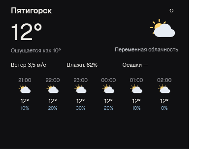

<p align="center">
  
</p>

<h1 align="center">NotchFlow</h1>

<p align="center">A compact Windows 11 desktop panel for media, weather, notes, and tasks.</p>

## Features

- **Media controls** for compatible Windows media sessions, with artwork, playback controls, and a progress display.
- **System volume and mute** from the expanded media panel.
- **Clock and weather** with a local clock and forecasts from Open-Meteo. Weather requests use the configured city or its coordinates.
- **Notes and tasks** stored locally alongside your settings in `%LOCALAPPDATA%\NotchFlow`.
- **Customizable layout** with floating and top-edge styles, scaling, animation settings, monitor selection, and a system tray menu.

## Screenshot



## System requirements

- Windows 11 22H2 or later (build 22621 or later), x64.
- The self-contained installer includes the .NET runtime.
- Weather updates require an internet connection.

## Releases

The installer is distributed as a GitHub Release asset. Download `NotchFlow-Setup.exe` from the release, close any running instance using **Exit** in the system tray, and run the installer. The setup installs for the current Windows user. Launch **NotchFlow** from the Start menu.

**Installer download:** pending the first GitHub Release.

<!-- After publishing the release, replace the pending line with [Download NotchFlow-Setup.exe](https://github.com/OWNER/REPOSITORY/releases/latest/download/NotchFlow-Setup.exe). -->

## Build from source

Install the .NET 10 SDK on Windows and run these commands from the repository root:

```powershell
dotnet restore NotchFlow.slnx --configfile NotchFlow/NuGet.Config
dotnet build NotchFlow.slnx -c Release --no-restore
dotnet run --project NotchFlow/NotchFlow.csproj -c Release --no-build
```

For release packaging, run `.\scripts\build.ps1 -ReleaseName release-0_3_4`, then compile `scripts/NotchFlow.iss` with Inno Setup. The installer is written to `Installer/`.

## Third-party notices

See [third-party notices](NotchFlow/THIRD-PARTY-NOTICES.md) for the bundled fonts and audio dependency.
